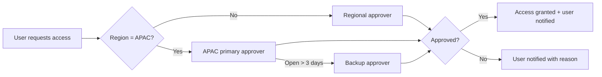

# User Stories, Acceptance Criteria and Test Cases

---

## Story 1: Client Profitability loads reliably (BL-01)

**As a** Finance analyst
**I want** the Client Profitability report to load every time I open it
**So that** I can review client margins without retrying or asking support.

**Acceptance criteria**
1. Failed-load rate is below 3% over 2 weeks after the fix (baseline before 15 Jun: 3.1%).
2. Average load time is under 6 seconds.
3. Numbers match the source (Databricks) within 0.5%.
4. If a scheduled refresh fails, the report owner gets an alert within 15 minutes.

**Dependencies:** data engineering fix to the query; access to the 15 Jun change log.

| Test ID | Type | Steps | Expected result |
|---------|------|-------|-----------------|
| TC-1.1 | Functional | Open report 20 times across different times of day | Loads every time, under 6s on average |
| TC-1.2 | Data reconciliation | Compare total revenue, total cost and margin for Q2 against a direct Databricks query | Difference under 0.5% |
| TC-1.3 | Functional | Apply each filter (client, region, quarter) | Visuals update correctly, no errors |
| TC-1.4 | Permissions | Log in as a user from another department without access | Access denied message with "Request access" link |
| TC-1.5 | Regression | Open Revenue Overview and Ops KPI Scorecard (same Databricks source) | Both still load and show the same numbers as before the fix |
| TC-1.6 | Functional | Force a refresh failure in the test environment | Alert email reaches the report owner within 15 minutes |

---

## Story 2: Pipeline Tracker is easy for Sales to use again (BL-02)

**As a** Sales manager
**I want** to see my team's open deals by stage on the first page, like before
**So that** I can prepare for weekly pipeline calls in under 5 minutes.

**Acceptance criteria**
1. The "Deals by stage" and "My team's open deals" views are on the landing page.
2. In a test with 5 Sales users, at least 4 find their team's pipeline in under 1 minute without help.
3. Sales monthly active users return to at least 65 within 2 months of release (June baseline: 70).
4. Sales satisfaction score returns to 3.8 or above.

**Dependencies:** findings from Sales interviews (BL-05); BI developer capacity.

| Test ID | Type | Steps | Expected result |
|---------|------|-------|-----------------|
| TC-2.1 | Functional | Open the report as a Sales manager | Landing page shows Deals by stage and My team's open deals |
| TC-2.2 | Functional | Click a stage in the funnel | Deal table filters to that stage |
| TC-2.3 | Permissions (row-level security) | Log in as a manager of Team A | Only Team A's deals are visible |
| TC-2.4 | Data reconciliation | Compare total open pipeline value with Salesforce for the same date | Values match exactly |
| TC-2.5 | Usability (UAT) | 5 Sales users find their team's pipeline without help | 4 of 5 succeed in under 1 minute |
| TC-2.6 | Regression | Check existing bookmarks and the Marketing Funnel report (shares the Salesforce source) | Bookmarks still work; Marketing Funnel numbers unchanged |

---

## Story 3: APAC users get report access within 3 days (BL-03)

**As an** APAC analyst
**I want** my access request approved within 3 working days
**So that** I am not blocked from my work while waiting.

**Acceptance criteria**
1. A backup approver is assigned for APAC.
2. Requests open for more than 3 days auto-escalate to the backup approver.
3. 90% of APAC requests are resolved within 3 days (currently 4%).

| Test ID | Type | Steps | Expected result |
|---------|------|-------|-----------------|
| TC-3.1 | Functional | Submit a request as an APAC user | Request goes to the primary approver and the user gets a confirmation |
| TC-3.2 | Functional | Leave the request open for 3 days in test | Auto-escalates to the backup approver |
| TC-3.3 | Permissions | Approve request, then open the report as that user | User can now see the report, with correct row-level security |
| TC-3.4 | Regression | Submit requests from India, Europe and North America | Flow for other regions is unchanged |

---

## Process flow: access request (after fix)

